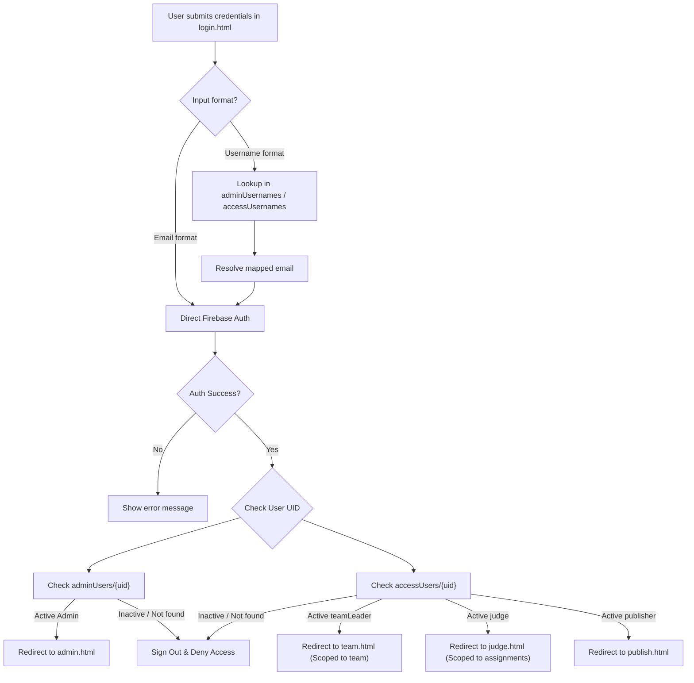

# Feastport — Festival & Competition Management System

Feastport is a real-time, multi-role festival and competition management web platform. It coordinates the entire lifecycle of an arts, cultural, academic, or sports festival: from master organizational configuration, participant registration, and stage scheduling to multi-judge scoring, result verification, live Stage TV projection, and automated certificate/poster generation.

The platform is built as a modular **Multi-Page Web Application (MPA)** using standard browser web technologies (**HTML5**, **CSS3 / Tailwind CSS**, **Vanilla JavaScript with ES Modules**) backed by **Google Firebase** (Firebase Authentication, Cloud Firestore, Cloud Functions, and Firebase Hosting).

---

## Table of Contents

1. [Architecture & Technology Stack](#1-architecture--technology-stack)
2. [Repository Directory Structure](#2-repository-directory-structure)
3. [Application Entry Points & Portals](#3-application-entry-points--portals)
4. [Firebase Connection & Setup](#4-firebase-connection--setup)
5. [Authentication & Role Access Control (RBAC)](#5-authentication--role-access-control-rbac)
6. [Cloud Firestore Database Architecture & Schemas](#6-cloud-firestore-database-architecture--schemas)
7. [Security Rules & Server-Side Enforcement](#7-security-rules--server-side-enforcement)
8. [Firebase Cloud Functions](#8-firebase-cloud-functions)
9. [Core Subsystems & Operational Workflows](#9-core-subsystems--operational-workflows)
   - [Master Setup & Capability Engine](#master-setup--capability-engine)
   - [Registration & Verification Workflow](#registration--verification-workflow)
   - [Time Schedule & Stage Program Management](#time-schedule--stage-program-management)
   - [Judgement Desk & Multi-Judge Scoring](#judgement-desk--multi-judge-scoring)
   - [Publishing & Real-Time Standings](#publishing--real-time-standings)
   - [Live Stage TV Display & Remote Control](#live-stage-tv-display--remote-control)
   - [Poster, Certificate & ID Card Engine](#poster-certificate--id-card-engine)
   - [Client-Side Image Compression Pipeline](#client-side-image-compression-pipeline)
   - [Safety & Data Reset Protocol](#safety--data-reset-protocol)
10. [Developer Maintenance & Extension Guide](#10-developer-maintenance--extension-guide)

---

## 1. Architecture & Technology Stack

Feastport avoids heavy frontend build steps and single-page framework overhead, ensuring instant loading, direct file editing, and long-term maintainability.

| Layer | Technology | Details |
|---|---|---|
| **Structure** | HTML5 | Semantic, accessible markup optimized for mobile, tablet, and desktop views. |
| **Styling** | CSS3 & Tailwind CSS | Responsive utility classes paired with custom responsive CSS. |
| **Client Logic** | Vanilla JavaScript (ES Modules) | Native ES6+ module imports (`import`/`export`), clean component separation, no bundle compiler needed. |
| **Database** | Google Cloud Firestore | NoSQL document database providing real-time document synchronization via `onSnapshot` listeners. |
| **Authentication** | Firebase Authentication | Secure email/password authentication mapped to custom username aliases. |
| **Server Operations** | Firebase Cloud Functions | Trusted server-side operations (e.g., Factory Reset, privileged verification). |
| **Hosting & CDN** | Firebase Hosting / Vercel | Static asset delivery with HTTPS and custom caching headers. |
| **Third-Party Utilities** | SheetJS (XLSX), jsPDF, html2canvas, html2pdf, Lucide Icons | Dynamically lazy-loaded on demand via `dependency-loader.js`. |

---

## 2. Repository Directory Structure

```text
feastport/
├── .github/                       # GitHub workflow and CI/CD actions
├── assets/
│   ├── css/                       # Shared custom stylesheets
│   └── templates/                 # Approved background assets for posters & ID cards
│       ├── rslt.png               # General Result Announcement poster background
│       ├── fst.png                # 1st Prize Winner poster background
│       ├── scd.png                # 2nd Prize Winner poster background
│       ├── trd.png                # 3rd Prize Winner poster background
│       ├── cert.png               # Official Certificate of Merit background
│       ├── lead-id.png            # Team Leader ID Card background
│       ├── jdg-id.png             # Judge ID Card background
│       ├── team-id.png            # Participant / Student ID Card background
│       ├── gst-id.png             # Guest ID Card background
│       └── vol-id.png             # Volunteer ID Card background
├── functions/                     # Firebase Cloud Functions (Node.js)
│   ├── index.js                   # Cloud Function exports (completeFactoryReset, verifyChest, etc.)
│   └── package.json               # Cloud Function dependencies
├── scripts/                       # Maintenance, verification, and audit helper scripts
├── admin.html                     # Central Administrative Console
├── admin-main.js                  # Primary controller for the Admin Console
├── admin-auth.js                  # Session authentication and profile gate for Admin Console
├── admin-dashboard.js             # Shared state and dashboard counters
├── admin-events.js                # Event management helpers
├── admin-students.js              # Student and chest number utilities
├── admin-utils.js                 # HTML sanitization, string formatting, print helpers
├── branding-config.js             # Festival branding, theme colors, and logo adapters
├── dependency-loader.js           # On-demand lazy loader for third-party libraries (XLSX, jsPDF, etc.)
├── event-utils.js                 # Event schema validation, column mapping, Excel import rules
├── fest-config.js                 # Festival setup presets, scoring normalization, capability engine
├── firebase-config.js             # Firebase SDK initialization and service export
├── firebase.json                  # Firebase project hosting and rules configuration
├── firestore.rules                # Cloud Firestore database security rules
├── storage.rules                  # Firebase Cloud Storage security rules
├── image-upload.js                # Client-side image canvas compressor (<200KB)
├── index.html                     # Public Festival Landing & Information Portal
├── judge.html                     # Judge Desk Scoring Interface
├── judge.js                       # Judge Desk application logic
├── login.html                     # Unified role-based login gateway
├── login.js                       # Role resolver and redirect controller
├── package.json                   # Local project scripts and metadata
├── poster-certificate-admin.js    # Poster & Certificate layout configuration UI
├── poster-certificate-engine.js   # Canvas and PDF rendering engine for certificates/posters
├── publish.html                   # Result verification and publisher workspace
├── register.html                  # Public and student registration application portal
├── registration-utils.js          # Eligibility check, quota calculation, application validation
├── results.html                   # Public Result Board and Team Standings portal
├── score-utils.js                 # Score calculations, criteria aggregation, tie-breaker logic
├── team.html                      # Team Leader Portal
├── tv.html                        # Full-screen Stage TV Live Presentation Display
├── tv-control.html                # Operator remote control panel for Fest TV
├── vercel.json                    # Vercel deployment headers and route configuration
├── _headers                       # Static security and caching headers
└── README.md                      # Comprehensive application documentation
```

---

## 3. Application Entry Points & Portals

Feastport consists of **10 distinct HTML pages**, each tailored to a specific user role or public presentation view:

### 1. `index.html` — Public Festival Home
The official public landing page. Displays festival branding, hero banners, live countdown, general statistics (total events, students, teams), participating team leaders, interactive public schedule with date/stage/category filters, and media gallery.

### 2. `results.html` — Public Results Portal
Displays official published competition results. Features real-time search, category/gender filters, winner cards (1st, 2nd, 3rd, and Grades), and the live **Team Championship Standings** leaderboard. Only results with `status === "published"` appear here.

### 3. `register.html` — Festival Registration Portal
Self-service registration gateway. Allows students, parents, staff, alumni, and guests to submit entries according to festival policies. Implements secure chest-number verification before granting access to student application forms.

### 4. `login.html` — Unified Role Login Gateway
The single authentication entry point for all administrative and operational staff. Accepts a username or email plus password, resolves username aliases via Firestore mapping collections, verifies the user's role, and routes the user directly to their respective portal:
- `admin` / `superAdmin` → `admin.html`
- `teamLeader` → `team.html`
- `judge` → `judge.html`
- `publisher` → `publish.html`

### 5. `admin.html` — Admin Console
The administrative core of the festival. Contains 15+ sub-workspaces accessible through sidebar navigation:
- **Dashboard:** Live operational counts (students, events, entries, results).
- **Master Setup:** Global mode selection (Basic vs. Advanced), teams, categories, scoring policies, capability toggles.
- **Team Setup:** Team names, brand colors, custom team logos, and ID card header text.
- **Students:** Directory management, chest number allocation, class/guardian details, bulk Excel import.
- **Events:** Event catalog, staging (On-Stage vs. Off-Stage), scoring methods, judge criteria, duration, Excel import.
- **Registrations:** Candidate approval, team limits, policy deadlines, registration lock timestamp.
- **Time Schedule:** Visual stage timeline builder, day/stage definitions, breaks, conflict detection.
- **Schedule Print:** Printable A4 schedule generator with custom columns, filters, and PDF preview.
- **Judgement:** Judge registry, stage-event assignments, score-sheet inspection, reopening submitted sheets.
- **Scoring Settings:** Point tables for individual/group events, grade boundaries, tie-breaking criteria.
- **Public Page Control:** Live text, announcements, hero images, and feature visibility toggles.
- **TV Display Settings:** Stage TV slide rotation, tickers, video playlists, and theme styling.
- **Poster & Certificate:** Visual template designer for winner posters, merit certificates, and ID cards.
- **Access Management:** User creation and credential management for team leaders, judges, and publishers.
- **Data Reset:** Scoped deletion tools, backup archives, and factory reset controls.

### 6. `team.html` — Team Leader Portal
A restricted portal scoped exclusively to the logged-in team leader's assigned team. Includes:
- **Team Dashboard:** Live team score, entry counts, category breakdown.
- **Events:** Eligible events catalogue for the team with remaining quota badges.
- **Registrations:** Participant entry submission and editing prior to the registration lock.
- **Schedule:** Team-specific program timetable and stage timings.
- **Reports:** Printable participation sheets and team entry export.

### 7. `judge.html` — Judge Scoring Desk
Designed for mobile tablets and laptops used by competition judges at stages:
- Lists assigned events with real-time status (Pending, Scoring, Submitted).
- Touch-friendly scoring sheet supporting Criteria breakdown, Objective marks, Time recordings, or Direct ranking.
- Auto-saving draft mode and final sheet submission with digital confirmation.

### 8. `publish.html` — Publisher Workspace
The quality assurance station between judges and the public. Publishers review submitted score sheets, resolve ties according to festival rules, assign final positions and grades, and publish the verified result.

### 9. `tv.html` — Stage TV Live Display
Full-screen presentation interface for large LED walls, auditorium screens, or TV sets. Continuously rotates upcoming programs, championship leaderboards, photo slides, YouTube videos, and breaking result reveals.

### 10. `tv-control.html` — TV Remote Control Panel
Operator panel to control the live Stage TV. Allows selecting specific published results to trigger cinematic winner reveal animations and podium podium sequences on screen.

---

## 4. Firebase Connection & Setup

The application connects to Firebase directly from the browser using modern ES Module imports from Google's CDN (`https://www.gstatic.com/firebasejs/11.0.2/...`).

### Configuration File: `firebase-config.js`

```javascript
import { initializeApp } from "https://www.gstatic.com/firebasejs/11.0.2/firebase-app.js";
import { getFirestore } from "https://www.gstatic.com/firebasejs/11.0.2/firebase-firestore.js";
import { getAuth } from "https://www.gstatic.com/firebasejs/11.0.2/firebase-auth.js";
import { getStorage } from "https://www.gstatic.com/firebasejs/11.0.2/firebase-storage.js";

const firebaseConfig = {
  apiKey: "YOUR_API_KEY",
  authDomain: "your-project.firebaseapp.com",
  projectId: "your-project-id",
  storageBucket: "your-project.appspot.com",
  messagingSenderId: "YOUR_SENDER_ID",
  appId: "YOUR_APP_ID"
};

export const app = initializeApp(firebaseConfig);
export const db = getFirestore(app);
export const auth = getAuth(app);
export const storage = getStorage(app);
```

### Initial Bootstrap Procedure (First-Time Setup)

Because Firestore security rules require an active `adminUsers` record to perform administrative actions, the very first administrator must be bootstrapped:
1. Open the **Firebase Console → Authentication → Users** and click **Add user**.
2. Enter the administrator's email and password. Copy the generated **User UID**.
3. Open **Firestore Database → Data** and create the collection `adminUsers`.
4. Create a document with the Document ID set to the **User UID**:
   ```json
   {
     "email": "admin@feastport.local",
     "username": "admin",
     "displayName": "Festival Administrator",
     "role": "admin",
     "active": true,
     "createdAt": 1700000000000
   }
   ```
5. Deploy `firestore.rules` and `functions/`.
6. Log in via `login.html` using the newly created credentials to access `admin.html`.

---

## 5. Authentication & Role Access Control (RBAC)

Feastport uses a secure two-tier authentication architecture:



### Roles and Capabilities

| Role | Access Target | Capabilities |
|---|---|---|
| `superAdmin` / `admin` | `admin.html` | Full operational control, master configuration, database resets, account creation. |
| `teamLeader` | `team.html` | Manages students and submits event registrations exclusively for their assigned team. |
| `judge` | `judge.html` | Evaluates only events explicitly assigned in `judgeAssignments`; submits score sheets. |
| `publisher` | `publish.html` | Verifies submitted judge sheets, computes tie-breaks, publishes results to public views. |
| `mediaEditor` | `admin.html` *(scoped)* | Limited access to Poster, Certificate, and Media branding controls without data reset powers. |

### Username Alias Resolution

To allow convenient short usernames on mobile devices without complex federated logins:
- **`adminUsernames/{username}`**: Maps an admin username to an email address.
- **`accessUsernames/{username}`**: Maps a staff/judge/team leader username to their email address.
If an administrator creates an access account with just a username, the system provisions the Firebase Auth account with the standard format `username@fest.local`.

---

## 6. Cloud Firestore Database Architecture & Schemas

### Overview of Collections

```text
Firestore Root
├── settings/
│   ├── general                      # Master festival configuration & metadata
│   ├── home_config                  # Public home branding & hero content
│   ├── public_config                # Feature toggles & public links
│   ├── scoring_rules                # Point matrices & tie-break policies
│   ├── schedule_config              # Timetable settings, stages, days & lock time
│   ├── tv_config                    # TV display parameters, ticker & playlist
│   └── registration_config          # Advanced application rules & category policies
├── students/{studentId}             # Registered student roster
├── participants/{participantId}     # Generalized participants (parents, staff, guests)
├── events/{eventId}                 # Event / program definitions
├── registrations/{registrationId}   # Approved competition entries
├── registrationRequests/{id}        # Incoming public registration requests
├── registrationApplications/{id}    # Verified student applications awaiting leader approval
├── teamRegistrationPolicies/{team}  # Team-specific quota and category overrides
├── results/{eventId}                # Published and archived competition results
├── judgeAssignments/{id}            # Mapping of judges to stages and events
├── judges/{uid}                     # Judge directory profiles
├── judgeScores/{id}                 # Score sheets submitted by judges
├── publicJudgingStatuses/{assignId} # Public real-time judging progress badges
├── scheduleBreaks/{id}              # Intermissions and stage break intervals
├── scheduleVersions/{versionId}     # Versioned schedule publication snapshots
├── adminUsers/{uid}                 # Admin profile & role gate
├── adminUsernames/{username}        # Admin username-to-email mapping
├── accessUsers/{uid}                # Staff profile records (teamLeader, judge, publisher)
├── accessUsernames/{username}       # Staff username-to-email mapping
├── teamLeaders/{uid}                # Public team leader contact display cards
├── auditLogs/{logId}                # Administrative action safety logs
└── deletedBackups/{backupId}        # Pre-deletion archives for data safety
```

---

### Detailed Schema Specifications

#### 1. `settings/general`
Stores the fundamental festival configuration:
```json
{
  "festSetup": {
    "eventManagementMode": "advanced",     // "basic" or "advanced"
    "allowedGenders": ["Boys", "Girls", "Both", "Mixed"],
    "competitionPolicies": { ... },
    "capabilities": {
      "schedule": true,
      "judging": true,
      "registration": true,
      "tv": true
    }
  },
  "categories": ["Sub-Junior", "Junior", "Senior", "General"],
  "categoryDisplayNames": { "Sub-Junior": "Kiddies" },
  "teams": ["Team A", "Team B", "Team C"],
  "teamDisplayNames": { "Team A": "Blue Tigers" },
  "teamColors": { "Team A": "#2563eb" },
  "teamLogos": { "Team A": "data:image/webp;base64,..." },
  "chestConfig": {
    "mode": "auto",                        // "auto" or "manual"
    "ranges": { "Team A": { "start": 101, "end": 199 } }
  }
}
```

#### 2. `settings/home_config`
Controls public festival identity and hero styling:
```json
{
  "festName1": "FEASTPORT",
  "festName2": "ARTS FEST 2026",
  "subtitle": "Inter-Collegiate Cultural Festival",
  "dates": "November 20 - 24, 2026",
  "venue": "Main Campus Auditorium",
  "logoUrl": "data:image/webp;base64,...",
  "bannerUrl": "https://...",
  "themeColor": "#4f46e5",
  "configured": true
}
```

#### 3. `settings/schedule_config`
Maintains schedule parameters and lock deadlines:
```json
{
  "title": "OFFICIAL PROGRAMME SCHEDULE",
  "registrationLockAt": 1763366400000,     // Timestamp in ms; locks registrations when passed
  "days": [
    { "id": "day_1", "label": "Day 1", "date": "2026-11-20" }
  ],
  "stages": [
    { "id": "stage_1", "name": "Main Auditorium" },
    { "id": "stage_2", "name": "Open Air Stage" }
  ],
  "printSettings": {
    "pageSize": "A4",
    "orientation": "portrait",
    "marginCm": 1.0,
    "colorMode": "color"
  }
}
```

#### 4. `settings/scoring_rules`
Defines point calculations:
```json
{
  "singlePoints": { "first": 5, "second": 3, "third": 1 },
  "groupPoints": { "first": 10, "second": 6, "third": 2 },
  "grades": [
    { "name": "A", "min": 80, "max": 100, "points": 5 },
    { "name": "B", "min": 60, "max": 79.99, "points": 3 },
    { "name": "C", "min": 40, "max": 59.99, "points": 1 }
  ]
}
```

#### 5. `students/{studentId}`
Individual student records:
```json
{
  "name": "Muhammed Adil",
  "chestNo": "101",
  "team": "Team A",
  "category": "Senior",
  "gender": "Boys",
  "class": "12 A",
  "photoData": "data:image/jpeg;base64,...", // Optional compressed thumbnail
  "details": {
    "guardianName": "Abdul Rahman",
    "phone": "9876543210"
  },
  "createdAt": 1763300000000
}
```

#### 6. `events/{eventId}`
Event definition and rules:
```json
{
  "code": "EV-01",
  "name": "Elocution English",
  "category": "Senior",
  "gender": "Both",                        // "Boys", "Girls", "Both", or "Mixed"
  "stage": "On-Stage",                     // "On-Stage" or "Off-Stage"
  "type": "Single",                        // "Single" or "Group"
  "entriesPerTeam": 2,                     // Max individual participants per team
  "groupLimit": null,                      // e.g., 5 if group event requires 5 members
  "resultWorkflow": "judged",              // "judged" or "direct"
  "resultMethod": "criteria",              // "criteria", "objective", "direct_rank", "time"
  "maximumMark": 100,
  "criteria": [
    { "key": "criterion_1", "name": "Content & Substance", "maximumMark": 40 },
    { "key": "criterion_2", "name": "Pronunciation & Delivery", "maximumMark": 30 },
    { "key": "criterion_3", "name": "Stage Presence", "maximumMark": 30 }
  ],
  "duration": 5,                           // in minutes
  "preparationTime": 2,                    // in minutes
  "rules": "1. Time limit: 5 minutes. 2. No notes permitted.",
  "status": "published"                    // "draft" or "published"
}
```

#### 7. `registrations/{registrationId}`
Official competition entry connecting participants to events:
```json
{
  "eventId": "event_123",
  "eventName": "Elocution English",
  "team": "Team A",
  "category": "Senior",
  "type": "Single",
  "studentId": "student_456",
  "studentName": "Muhammed Adil",
  "chestNo": "101",
  "members": [],                           // Populated if type === "Group"
  "stage": "On-Stage",
  "registeredAt": 1763320000000,
  "registeredByUid": "auth_user_uid"
}
```

#### 8. `results/{eventId}`
Verified competition outcome:
```json
{
  "eventId": "event_123",
  "eventName": "Elocution English",
  "category": "Senior",
  "stage": "On-Stage",
  "type": "Single",
  "status": "published",                   // "draft", "ready", "published", "archived"
  "publishedAt": 1763380000000,
  "winners": [
    {
      "position": "1",
      "studentId": "student_456",
      "name": "Muhammed Adil",
      "chestNo": "101",
      "team": "Team A",
      "grade": "A",
      "points": 5,
      "totalMark": 94.5
    }
  ],
  "teamPoints": {
    "Team A": 5,
    "Team B": 3
  }
}
```

#### 9. `judgeScores/{scoreId}`
Score sheet submitted by a judge:
```json
{
  "assignmentId": "assignment_789",
  "eventId": "event_123",
  "judgeUid": "judge_auth_uid",
  "judgeName": "Dr. K. Sharma",
  "status": "submitted",                   // "draft" or "submitted"
  "submittedAt": 1763375000000,
  "scores": [
    {
      "chestNo": "101",
      "registrationId": "reg_001",
      "criteriaMarks": { "criterion_1": 38, "criterion_2": 28, "criterion_3": 28 },
      "totalMark": 94,
      "remarks": "Excellent articulation"
    }
  ]
}
```

---

## 7. Security Rules & Server-Side Enforcement

Access control is enforced at the database layer via `firestore.rules` and `storage.rules`. The client interface never relies purely on UI disabling for security.

### Core Security Principles in `firestore.rules`

1. **Role Verification Functions:**
   - `isAdmin()`: Validates `request.auth != null` and checks that `adminUsers[request.auth.uid].active == true`.
   - `isTeamLeader(team)`: Confirms `accessUsers[request.auth.uid]` has role `teamLeader`, is active, and matches the document's `team` field.
   - `isJudge()`: Confirms active `judge` role and verifies document assignment.
   - `isPublisher()`: Confirms active `publisher` or `admin` role.

2. **Collection Permissions:**
   - **`settings/*`**: Publicly readable; writable **only** by `isAdmin()`.
   - **`students/*`**: Publicly readable (or restricted to authenticated users depending on preset); writable **only** by `isAdmin()`.
   - **`registrations/*`**: Readable by all; creatable/editable by `isTeamLeader(team)` **only if** `request.time < registrationLockAt`; fully manageable by `isAdmin()`.
   - **`results/*`**: Readable by all only when `resource.data.status == "published"`; writable **only** by `isPublisher()` or `isAdmin()`.
   - **`judgeScores/*`**: Readable only by assigned judge or admin; writable by the assigned judge **only** while in `draft` state or upon final submission.

---

## 8. Firebase Cloud Functions

Server-side operations requiring super-user privileges or bypass of client network constraints live in `functions/index.js`.

### `completeFactoryReset`
A privileged HTTPS Callable function that completely wipes all festival operational data while safeguarding core admin credentials:
1. Validates the caller's Firebase Authentication token.
2. Checks that `adminUsers/{uid}` exists and has role `admin` or `superAdmin`.
3. Recursively enumerates and deletes all documents across operational collections: `students`, `events`, `registrations`, `results`, `judgeAssignments`, `judgeScores`, `auditLogs`, `notifications`, etc.
4. **Preserves** `adminUsers`, `adminUsernames`, and administrative records in `accessUsers`.
5. Logs the reset action with the executing admin's UID and timestamp.

---

## 9. Core Subsystems & Operational Workflows

### Master Setup & Capability Engine
Administrators can choose between two fundamental operational modes:
- **Basic Mode:** Designed for single-day or smaller events. Disables date, stage, and complex judging assignments. Programs follow a simple linear sequence with direct publisher scoring.
- **Advanced Mode:** Enables full multi-day scheduling, stage management, multi-judge criteria scoring, registration lockouts, and live TV presentation queues.

### Registration & Verification Workflow
1. **Student Registration:** Students or parents navigate to `register.html`, choose their team and gender, enter their exact issued Chest Number, and pass automated verification.
2. **Quota Check:** The system verifies team quotas (`entriesPerTeam`), group size bounds (`groupLimit`), and category eligibility.
3. **Team Leader Finalization:** In Advanced mode, student entries arrive as `registrationApplications`. Team leaders review, approve, and finalize selections within team limits before the `registrationLockAt` deadline.

### Time Schedule & Stage Program Management
- The Admin Console provides a visual timetable builder to assign events to specific days, stages, and start times.
- Programs can be automatically shifted or adjusted with intermission breaks (`scheduleBreaks`).
- Conflict detection alerts operators if an individual participant or judge is scheduled across multiple stages at the same time.
- **A4 Schedule Printing:** Generates publication-ready PDF timetables with Malayalam and English typography support.

### Judgement Desk & Multi-Judge Scoring
- Judges log into `judge.html` using their assigned mobile tablet or laptop.
- Only events assigned to that judge via `judgeAssignments` are visible.
- Supports multiple scoring methods:
  - **Criteria-based:** Scoring itemized criteria (e.g., Tone, Rhythm, Diction).
  - **Objective:** Direct score calculation with penalty deductions.
  - **Time-based:** Clock recording where lowest or highest duration wins.
  - **Direct Rank:** Direct selection of 1st, 2nd, and 3rd place.
- Multiple judges on a single event can be aggregated via Average, Trim Extremes (dropping highest and lowest marks), or Weighted scores.

### Publishing & Real-Time Standings
- When score sheets are submitted, the status syncs in real time to `publish.html`.
- Publishers inspect marks, review tie-breaking suggestions, and assign final ranks and grades.
- Once clicked **Publish**, results write to `results/{eventId}`, which immediately:
  - Updates the public `results.html` board.
  - Recalculates team championship points.
  - Broadcasts breaking updates to live Stage TVs.

### Live Stage TV Display & Remote Control
- `tv.html` runs in full-screen on display monitors and LED backdrops.
- Features a self-adjusting rotation loop:
  1. Upcoming program schedule cards.
  2. Live Team Championship Leaderboard.
  3. Video wall / YouTube live streams / photo slides.
  4. Announcements ticker.
- When results are announced, operators trigger **Results Mode** from `tv-control.html`, displaying an animated podium sequence (3rd → 2nd → 1st place reveals) with sound effects.

### Poster, Certificate & ID Card Engine
Feastport includes a built-in browser-based graphics engine (`poster-certificate-engine.js`):
- Renders pixel-perfect winner announcement posters, student merit certificates, and staff ID cards.
- Background graphics reside in `assets/templates/` as approved PNG files:
  - `rslt.png`, `fst.png`, `scd.png`, `trd.png` (Posters)
  - `cert.png` (Certificates)
  - `team-id.png`, `lead-id.png`, `jdg-id.png`, `gst-id.png`, `vol-id.png` (ID Cards)
- Only coordinate layout geometries and font styles are saved in Firestore. The final output is rendered client-side on an HTML5 `<canvas>` and exported as high-resolution PNG or printable vector PDF.

### Client-Side Image Compression Pipeline
To guarantee speed and prevent Firestore document bloat:
- All photo uploads (student photos, branding logos, team badges) pass through `image-upload.js`.
- Automatically scales and compresses images to JPEG/WebP format under **200 KB** before saving as a Base64 string or uploading to Cloud Storage.

### Safety & Data Reset Protocol
- Before any destructive action, the system loads the affected record count and requires typing an exact confirmation phrase.
- Specific deletions create automated snapshots in `deletedBackups`.
- A factory reset requires two-factor confirmation (typing `DELETE EVERYTHING` and re-authenticating with the administrator's email).

---

## 10. Developer Maintenance & Extension Guide

Follow these guidelines when updating or extending Feastport:

### 1. Maintain Strict Language Separation
- **Application User Interface:** All interface elements—buttons, titles, headers, dialogs, form labels, toasts, placeholders, and error messages—**must remain in English only**.
- Do not introduce Malayalam, Arabic, or non-English text into code strings or interface controls unless explicitly authorized for a specific localized content field.

### 2. Preserve the Vanilla JS ES Module Architecture
- Do not attempt to rewrite or migrate this project to React, Next.js, Vue, Angular, or TypeScript without explicit approval.
- Keep dependencies minimal. Use native browser APIs (`fetch`, `document.querySelector`, `Promise`, `localStorage`).

### 3. On-Demand Dependency Rule (Speed & Performance)
- Heavy libraries like SheetJS (`XLSX`), `jsPDF`, `html2canvas`, and `html2pdf` must **never** be placed as synchronous parser-blocking `<script>` tags in `<head>`.
- Always load them lazily using `dependency-loader.js`:
  ```javascript
  // Example: Inside an Excel export function
  await window.ensureDep?.('XLSX');
  if (!window.XLSX) return;
  // Proceed with XLSX workbook generation
  ```

### 4. Firestore Listener Hygiene & Tab Optimization
- On large views like `admin.html`, do not eagerly rebuild large DOM tables for inactive/hidden tabs when snapshot listeners fire.
- Always check if the tab is visible before heavy DOM rendering:
  ```javascript
  const isTabActive = tabId => Boolean(document.getElementById('view-' + tabId)?.classList.contains('active'));

  if (isTabActive('students')) {
    window.renderStudentTable();
  }
  ```
- Summary numbers and statistics (`window.updateStats()`) should be computed in memory and updated lightly.

### 5. Adding New Collections or Event Fields
1. Define the field in `fest-config.js` or `event-utils.js`.
2. Update the corresponding form in `admin.html`.
3. Add the field to `firestore.rules` under the appropriate collection permission block.
4. Verify both read and write permissions with different role accounts.

---

## License

Copyright © 2026 Feastport. All rights reserved.
Unauthorized copying, modification, distribution, or public display of this software and its associated documentation files is strictly prohibited.
